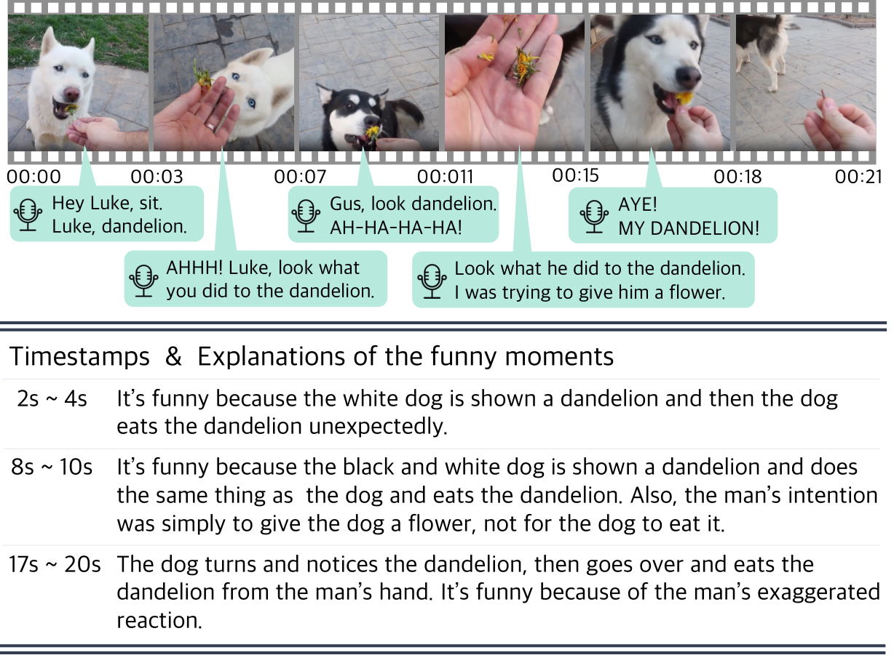

  Hi! I’m Dayoon Ko 😊, a Ph.D. candidate in Computer Science and Engineering at SNU, advised by <a href="https://vision.snu.ac.kr/gunhee/" target="_blank">Gunhee Kim</a>. Currently, I’m a visiting researcher at <strong>UC Berkeley</strong>, working with <a href="https://www.sewonmin.com/" target="_blank">Sewon Min</a>.
    
  I love to define practical problems that appear when people use AI in the real world. Recently, I’ve been focusing on on-device multimodal retrieval, where models search over what people see and keep on their own devices, under tight memory and compute budgets. Before that, I asked whether search agents can find the papers researchers actually need and verify what they claim, and how LLMs and RAG systems keep up with evolving knowledge. Also, I feel excited when I finally find out how to solve the problems! That has meant scaling search agents with parallel and sequential reasoning, and detecting when a retriever needs an update. My first project explored video humor, an extreme case of implicit multimodal understanding.
    
  Outside of research, I enjoy dancing 💃 or doing CrossFit 🏋🏻‍♀️. Staying active keeps my brain happy!



  <h2>🔥 Recent News</h2>
  

    <strong>[Oct 2026]</strong> Joined Sewon Min's group at <strong>UC Berkeley</strong> 🐻 as a visiting researcher!
  

  

    <strong>[Oct 2026]</strong> New paper release! <a href="https://dayoon-ko.github.io/CompLit/" target="_blank"><strong>"CompLit"</strong></a>: a scientific literature search benchmark for implicit, cumulative, and unmet needs.
  

  

    <strong>[Oct 2026]</strong> New paper release! <a href="https://arxiv.org/abs/2610.02202" target="_blank"><strong>"ScholarCatalyst"</strong></a>: a benchmark for finding papers that inspire new research.
  

  

    <strong>[Sep 2026]</strong> Received the <strong>Youlchon AI Star Fellowship</strong>! 🎉
  

  

    <strong>[Sep 2026]</strong> <a href="https://arxiv.org/abs/2606.02404" target="_blank"><strong>"K-BrowseComp"</strong></a> accepted to <strong>EMNLP 2026 Findings</strong>! 🎉
  

  

    <strong>[Sep 2026]</strong> <a href="https://arxiv.org/abs/2602.07549" target="_blank"><strong>"Illusory Completion in Search Agents"</strong></a> accepted to the <strong>Workshop on Agent Behavior</strong> at COLM 2026! 🎉
  

  <!-- 

    <strong>[May 2025]</strong> Two papers accepted at <strong>ACL 2025</strong>! "GradNormIR" (Findings) and "Can LLMs Deceive CLIP?" (Main)
  
 -->

<h2 class="section-title" id="publications">Publications</h2>

  

    
  

  

    
CompLit: Scientific Literature Search Benchmarks Must Cover Implicit, Cumulative, and Unmet Needs

    
<strong>Dayoon Ko</strong>, Jihyuk Kim, Soyeong Jeong, Young-Jun Lee, Dahyun Lee, Juyeon Kim, Gunhee Kim, Moontae Lee, Kyungjae Lee

    
arXiv 2026

    

      <a href="https://arxiv.org/abs/2610.28658" target="_blank" style="color: #4a90e2; text-decoration: none; font-size: 14px; margin-right: 5px;">[Paper]</a>
      <a href="https://dayoon-ko.github.io/CompLit/" target="_blank" style="color: #4a90e2; text-decoration: none; font-size: 14px; margin-right: 5px;">[Project Page]</a>
      <a href="https://github.com/dayoon-ko/CompLit" target="_blank" style="color: #4a90e2; text-decoration: none; font-size: 14px; margin-right: 5px;">[Code]</a>
      <a href="https://huggingface.co/datasets/dayoon/CompLit" target="_blank" style="color: #4a90e2; text-decoration: none; font-size: 14px;">[Dataset]</a>
    

  

  

    
  

  

    
ScholarCatalyst: A Benchmark for Retrieving Papers That Inspire New Research

    
Sohyeon Kim, Yoonho Lee, Bo Liu, <strong>Dayoon Ko</strong>, Rulin Shao, Seungone Kim, Graham Neubig, Pang Wei Koh, Aakanksha Chowdhery, Akari Asai, Omar Khattab, Yejin Choi, Gunhee Kim, Chelsea Finn

    
arXiv 2026

    

      <a href="https://arxiv.org/abs/2610.02202" target="_blank" style="color: #4a90e2; text-decoration: none; font-size: 14px; margin-right: 5px;">[Paper]</a>
      <a href="https://github.com/stanford-iris-lab/ScholarCatalyst" target="_blank" style="color: #4a90e2; text-decoration: none; font-size: 14px; margin-right: 5px;">[Code]</a>
      <a href="https://huggingface.co/datasets/ScholarCatalyst/ScholarCatalyst" target="_blank" style="color: #4a90e2; text-decoration: none; font-size: 14px;">[Dataset]</a>
    

  

  

    
  

  

    
K-BrowseComp: A Web Browsing Agent Benchmark Grounded in Korean Contexts

    
Nahyun Lee, Dongkeun Yoon, Guijin Son, Geewook Kim, <strong>Dayoon Ko</strong>, Jeonghun Park, Haneul Yoo, Jaewon Cho, Junghun Park, Changyoon Lee, Kyochul Jang, Jaeyeon Kim, Eunsu Kim, Woojin Cho, Seungone Kim

    
EMNLP 2026 Findings

    

      <a href="https://arxiv.org/abs/2606.02404" target="_blank" style="color: #4a90e2; text-decoration: none; font-size: 14px; margin-right: 5px;">[Paper]</a>
      <a href="https://github.com/prometheus-eval/K-BrowseComp" target="_blank" style="color: #4a90e2; text-decoration: none; font-size: 14px;">[Code]</a>
    

  

  

    
  

  

    
When Is Enough Not Enough? Illusory Completion in Search Agents

    
<strong>Dayoon Ko</strong>, Jihyuk Kim, Sohyeon Kim, Haeju Park, Dahyun Lee, Gunhee Kim, Moontae Lee, Kyungjae Lee

    
COLM 2026 Workshop on Agent Behavior

    

      <a href="https://arxiv.org/abs/2602.07549" target="_blank" style="color: #4a90e2; text-decoration: none; font-size: 14px; margin-right: 5px;">[Paper]</a>
      <a href="https://github.com/dayoon-ko/illusory_completion" target="_blank" style="color: #4a90e2; text-decoration: none; font-size: 14px;">[Code]</a>
    

  

  

    
  

  

    
Hybrid Deep Searcher: Scalable Parallel and Sequential Search Reasoning

    
<strong>Dayoon Ko</strong>, Jihyuk Kim, Haeju Park, Sohyeon Kim, Dahyun Lee, Yongrae Jo, Gunhee Kim, Moontae Lee, Kyungjae Lee

    
ICLR 2026

    

      <a href="https://openreview.net/forum?id=rXpTZyucal" target="_blank" style="color: #4a90e2; text-decoration: none; font-size: 14px; margin-right: 5px;">[Paper]</a>
      <a href="https://github.com/dayoon-ko/HybridDeepSearcher" target="_blank" style="color: #4a90e2; text-decoration: none; font-size: 14px; margin-right: 5px;">[Code]</a>
      <a href="https://hybriddeepsearcher.github.io/" target="_blank" style="color: #4a90e2; text-decoration: none; font-size: 14px;">[Project Page]</a>
    

  

  

    
  

  

    
When Should Dense Retrievers Be Updated in Evolving Corpora? Detecting Out-of-Distribution Corpora Using GradNormIR

    
<strong>Dayoon Ko</strong>, Jinyoung Kim, Sohyeon Kim, Jinhyuk Kim, Jaehoon Lee, Seonghak Song, Minyoung Lee, Gunhee Kim

    
ACL 2025 Findings

    

      <a href="https://arxiv.org/abs/2506.01877" target="_blank" style="color: #4a90e2; text-decoration: none; font-size: 14px; margin-right: 5px;">[Paper]</a>
      <a href="https://github.com/dayoon-ko/gradnormir" target="_blank" style="color: #4a90e2; text-decoration: none; font-size: 14px;">[Code]</a>
    

  

  

    
  

  

    
Can LLMs Deceive CLIP? Benchmarking Adversarial Compositionality of Pre-trained Multimodal Representation via Text Updates

    
Jaewoo Ahn, Heeseung Yun, <strong>Dayoon Ko</strong>, Gunhee Kim

    
ACL 2025

    

      <a href="https://arxiv.org/abs/2505.22943" target="_blank" style="color: #4a90e2; text-decoration: none; font-size: 14px; margin-right: 5px;">[Paper]</a>
      <a href="https://github.com/ahnjaewoo/MAC" target="_blank" style="color: #4a90e2; text-decoration: none; font-size: 14px;">[Code]</a>
    

  

  

    
  

  

    
DynamicER: Resolving Emerging Mentions to Dynamic Entities for RAG

    
Jinyoung Kim, <strong>Dayoon Ko</strong>, Gunhee Kim

    
EMNLP 2024

    

      <a href="https://arxiv.org/abs/2410.11494" target="_blank" style="color: #4a90e2; text-decoration: none; font-size: 14px; margin-right: 5px;">[Paper]</a>
      <a href="https://github.com/jiny1623/DynamicER" target="_blank" style="color: #4a90e2; text-decoration: none; font-size: 14px;">[Code]</a>
    

  

  

    
  

  

    
GrowOVER: How Can LLMs Adapt to Growing Real-World Knowledge?

    
<strong>Dayoon Ko</strong>, Jinyoung Kim, Hahyeon Choi, Gunhee Kim

    
ACL 2024

    

      <a href="https://aclanthology.org/2024.acl-long.181/" target="_blank" style="color: #4a90e2; text-decoration: none; font-size: 14px; margin-right: 5px;">[Paper]</a>
      <a href="https://github.com/dayoon-ko/GrowOVER" target="_blank" style="color: #4a90e2; text-decoration: none; font-size: 14px;">[Code]</a>
    

  

  

    
  

  

    
Can Language Models Laugh at YouTube Short-form Videos?

    
<strong>Dayoon Ko</strong>, Sangho Lee, Gunhee Kim

    
EMNLP 2023

    

      <a href="https://aclanthology.org/2023.emnlp-main.176/" target="_blank" style="color: #4a90e2; text-decoration: none; font-size: 14px; margin-right: 5px;">[Paper]</a>
      <a href="https://github.com/dayoon-ko/ExFunTube" target="_blank" style="color: #4a90e2; text-decoration: none; font-size: 14px;">[Code]</a>
    

  

  <h2 class="section-title">Experiences</h2>
  
  

    
Visiting Researcher

    
UC Berkeley

    
Hosted by Sewon Min

    
October 2026 - Present

  

  

    
Research Intern

    
LG AI Research, Superintelligence Lab

    
Worked on agentic reasoning and retrieval systems for large language models

    
March 2025 - September 2026

  

  <h2 class="section-title">Education</h2>
  
  

    
M.S./Ph.D. in Computer Science and Engineering

    
Seoul National University

    
Advisor: Gunhee Kim

    
September 2022 - Present

  

  

    
B.S. in Computer Science and Engineering

    
Yonsei University

    
GPA: 4.12/4.30 (Rank: 1/28)

    
March 2018 - August 2022

  

  <h2 class="section-title">Honors</h2>
  

    
Youlchon AI Star Fellowship

    
Youlchon Foundation and Seoul National University AI Institute

    
2026

  

  

    
Graduation Exhibition Excellence Award

    
Yonsei University, Computer Science

    
Project on mitigating data imbalance in image classification

    
Feb 2022

  

  

    
Udeok Scholarship

    
Udeok Foundation

    
Academic excellence scholarship, with full tuition during undergraduate years

    
Feb 2019 - Aug 2022

  

  

    
Academic Excellence Award

    
Yonsei University

    
For semester grades

  

